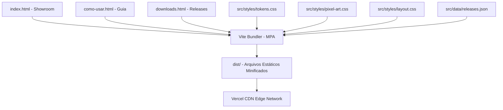

# Arquitetura e Stack Técnica

O `karasudo-site` foi concebido com uma premissa inegociável: **máximo desempenho estático, zero dependências pesadas de runtime cliente e acessibilidade universal (WCAG 2.2 AA)**.

---

## 1. Decisão Arquitetural (ADR 0001)

Conforme registrado formalmente em `docs/architecture/adr/0001-stack-estatica-vite.md`:

- **Abordagem:** HTML5 Semântico + CSS3 Puro + JavaScript Baunilha leve.
- **Ferramenta de Build:** Vite 8 (desenvolvimento local com HMR e compilação de produção).
- **Sem Frameworks Cliente:** Sem React, sem Vue, sem Angular e sem hydration. O navegador recebe o HTML pronto e renderiza no primeiro quadro (First Contentful Paint imediato).

---

## 2. Estrutura Multi-Páginas (MPA)

Em vez de empilhar dezenas de seções em uma única página longa ("one-pager"), o site utiliza a configuração de Multi-Page App do Vite:

| Página | Arquivo | Responsabilidade |
| ------ | ------- | ---------------- |
| **Início** | `index.html` | Apresentação rápida do produto, hero com download estável, vitrine viva do escritório e direcionamento. |
| **Como Usar** | `como-usar.html` | Guia completo passo a passo de instalação, comandos de mod/hooks, atalhos de teclado (`P`, `T`, `M`) e status dos agentes. |
| **Downloads** | `downloads.html` | Central com botões diretos de `.zip` e `.tar.gz`, requisitos mínimos, Docker e histórico completo das 13 versões. |

---

## 3. Design Tokens e Pixel Art Autêntico (Taste Skill)

A identidade visual segue as diretrizes do `tasteskill.dev` para evitar vícios e clichês de IA:

- **Nitidez de Pixel:** Uso estrito de `image-rendering: pixelated;` em imagens e telas retro.
- **Relevo Tátil:** Botões inspirados em consoles e teclados físicos com bordas de relevo mecânico, sem gradientes neon ou glassmorphism genérico.
- **Keycaps Retro:** Elementos `<kbd class="ui-kbd">` estilizados como teclas reais para facilitar a memorização de atalhos.
- **Acessibilidade:** Skip links para teclado, foco visível com `outline: 2px solid #7cc8ff`, e contraste mínimo de 4.5:1 para texto normal e 3:1 para elementos de interface.
