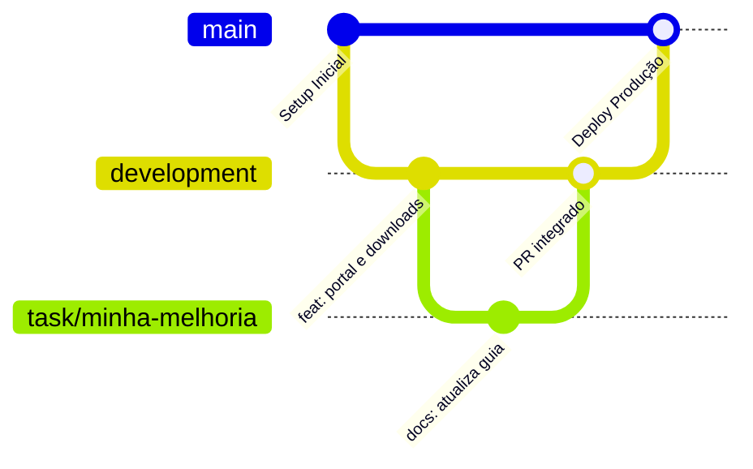

# Guia de Publicação e Deploy

Este documento detalha o fluxo de desenvolvimento, branches protegidas, integração contínua (CI) e o processo de deploy na Vercel.

---

## 1. Estrutura de Branches

O repositório segue o padrão formal:



- **`main`:** Branch de produção. Tudo o que está aqui é publicado automaticamente no domínio oficial [karasudo.darioreis.dev](https://karasudo.darioreis.dev/).
- **`development`:** Branch de integração para todas as tarefas em andamento.
- **Branches de Tarefa (`tipo/descricao-curta`):** Criadas a partir de `development` para implementação de novos recursos, ajustes ou documentação.

---

## 2. Deploy Automatizado na Vercel

O projeto está conectado à **Vercel** através da integração nativa com o GitHub.

- **Arquivo de Configuração (`vercel.json`):**
  ```json
  {
    "$schema": "https://openapi.vercel.sh/vercel.json",
    "cleanUrls": true,
    "framework": "vite",
    "buildCommand": "npm run build",
    "outputDirectory": "dist"
  }
  ```
- **Ambiente de Produção:** Qualquer merge ou push na branch `main` dispara o build automático e atualiza o site na CDN global da Vercel em segundos.
- **Preview Deployments:** Pull requests abertos contra a `main` ou `development` geram URLs temporárias de pré-visualização para testes antes do merge.

---

## 3. Regra de Ouro Antes de Todo Push / Release

Antes de enviar qualquer commit para produção:

1. **Revisar o README:** O `README.md` deve refletir fielmente novas rotas, comandos e comportamentos.
2. **Revisar a Wiki:** Conferir se as páginas em `wiki/` precisam de atualização.
3. **Validar a Integridade da Wiki:** Rodar `npm run wiki:check` para garantir que nenhum link interno ou bloco mermaid esteja quebrado.
4. **Executar a Auditoria:** Rodar `npm run audit` e `npm run build` para certificar-se de que nada quebrou a responsividade ou introduziu vícios de IA.
