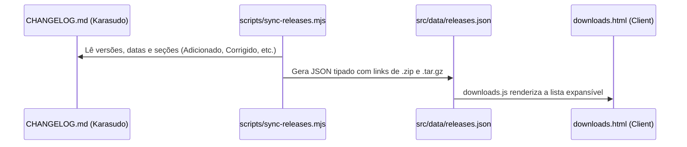

# Sincronização de Releases e Histórico

A página de downloads e o histórico de versões do Karasudo Site são alimentados por um processo automatizado e determinístico, extraído diretamente do repositório da aplicação principal.

---

## 1. Como Funciona

A aplicação do Karasudo mantém o arquivo canônico `CHANGELOG.md` estruturado no padrão [Keep a Changelog](https://keepachangelog.com/pt-BR/1.1.0/).

O script [`scripts/sync-releases.mjs`](file:///e:/Projetos/karasudo-site/scripts/sync-releases.mjs) faz o parsing desse arquivo e gera a base de dados estática em `src/data/releases.json`:



---

## 2. Como Atualizar uma Nova Versão

Quando uma nova versão do Karasudo for lançada (ex: `0.3.2` ou `0.4.0`):

1. Execute o comando de sincronização:
   ```bash
   node scripts/sync-releases.mjs
   ```
2. O script atualizará `src/data/releases.json` incluindo a nova versão no topo como `latest: true` e gerando os links de download correspondentes.
3. Teste o build:
   ```bash
   npm run build
   ```
4. Comite as alterações no padrão:
   ```bash
   feat(content): sincroniza versoes com a release v0.4.0
   ```
